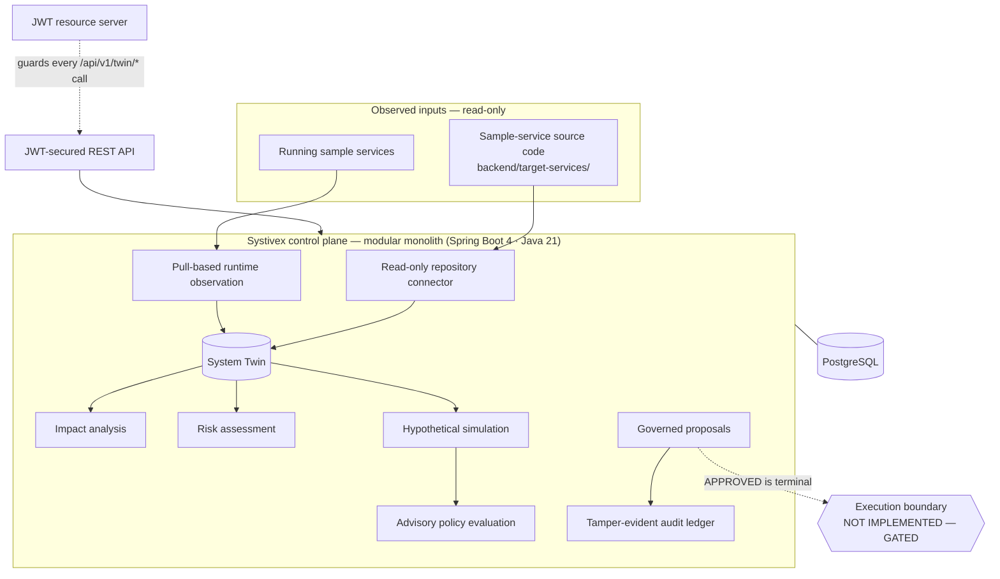

<div align="center">

# 🧠 Systivex

### Software-System Twin & Change Intelligence Platform

<p>
Systivex builds a living <b>System Twin</b> of a software system so every proposed change
can be reasoned about before anyone makes it. It deterministically analyses impact,
assesses risk, simulates outcomes, evaluates policy, and records each decision in a
governed, tamper-evident ledger.
</p>


[](https://github.com/soubhagya-behera/systivex/actions/workflows/backend-ci.yml)
[](LICENSE)

**[The Problem](#-the-problem) • [Features](#-features) • [Architecture](#-architecture-at-a-glance) • [Capabilities](#-capabilities-and-status) • [Quick Start](#-quick-start) • [Security](#-security-and-execution-boundaries)**

</div>

---

## 🎯 The Problem

| Engineering Problem | The Systivex Approach |
| --- | --- |
| Dependencies are implicit and easy to miss | Persist a twin of services, APIs, databases, and their relationships |
| Change impact is guessed rather than measured | Deterministic breadth-first impact analysis over the twin graph |
| Risk is subjective and inconsistent | Ordinal `LOW`/`MEDIUM`/`HIGH`/`UNKNOWN` risk from impact paths and runtime facts |
| Proposed-change consequences are difficult to assess before rollout | Hypothetical before/after simulation — nothing is executed |
| Decisions are hard to audit | Governed proposals plus a hash-chained, verifiable audit ledger |

---

## ✨ Features

<table>
<tr><td width="50%"><strong>🧬 Persisted System Twin</strong><br/>A durable graph of services, APIs, databases, tables, and relationships in PostgreSQL.</td>
<td width="50%"><strong>🔎 Read-only Synchronization</strong><br/>A connector loads source repositories and target services into twin rows without modifying anything.</td></tr>
<tr><td width="50%"><strong>🧭 Change-Impact Analysis</strong><br/>Deterministic graph traversal returns ordered evidence paths for a proposed change.</td>
<td width="50%"><strong>⚠️ Risk Assessment</strong><br/>Ordinal risk classification from impact paths and runtime facts; advisory, never authorization.</td></tr>
<tr><td width="50%"><strong>🧪 Hypothetical Simulation</strong><br/>Before/after comparison over an in-memory graph, marked <code>simulated</code> and never persisted.</td>
<td width="50%"><strong>📋 Advisory Policy Evaluation</strong><br/><code>ALLOW</code> / <code>REVIEW</code> / <code>DENY</code> over the simulated change — an input to judgement, not permission.</td></tr>
<tr><td width="50%"><strong>🗳️ Governed Proposals</strong><br/>Immutable revisions with assessment, submission, and human approval or rejection under separation of duties.</td>
<td width="50%"><strong>🔐 Tamper-evident Audit</strong><br/>A hash-chained, append-only ledger with an endpoint that verifies chain integrity.</td></tr>
<tr><td width="50%"><strong>🛡️ JWT-protected API</strong><br/>Every <code>/api/v1/twin/*</code> endpoint requires a validated OAuth2 bearer token and an allowlisted role.</td>
<td width="50%"><strong>📡 Runtime Observation</strong><br/>Pull-based health and allowlisted business counters feed the twin; the telemetry stack is local-only.</td></tr>
</table>

---

## 🏗️ Architecture at a Glance



Full design, trust boundaries, and the deterministic-vs-advisory distinction live in
[`ARCHITECTURE.md`](ARCHITECTURE.md).

---

## 🧩 Capabilities and Status

| Capability | Status |
| --- | --- |
| System-twin persistence and REST | ✅ Implemented and tested |
| Read-only repository synchronization | ✅ Implemented and tested |
| Deterministic change-impact analysis | ✅ Implemented and tested |
| Change-risk assessment (deterministic, advisory) | ✅ Implemented and tested |
| Hypothetical change simulation | ✅ Implemented and tested |
| Advisory policy evaluation | ✅ Implemented and tested |
| Governed proposals and human decisions | ✅ Implemented and tested |
| Tamper-evident audit verification | ✅ Implemented and tested |
| JWT-protected API | ✅ Implemented and tested |
| Runtime observation and telemetry integration | ✅ Implemented and tested |
| Controlled execution | 🚧 Design-only — gated by D30/D31 |
| Frontend / operator console | 🚧 Phase 13 S1, S2, and S3 merged; local-development-only |
| Agent orchestration, verification, Git integration | 📋 Planned, not implemented |

Impact, risk, and simulation derive deterministically from the twin and never authorize
change. Risk and policy evaluation are advisory; simulation is hypothetical and never
executes. See [`PROJECT_STATUS.md`](PROJECT_STATUS.md) and [`DECISIONS.md`](DECISIONS.md).

---

## 🚀 Quick Start

**Prerequisites:** JDK 21 and, for the tests, a running **Docker** daemon (Testcontainers
starts a throwaway PostgreSQL 18).

```bash
cd backend
chmod +x ./mvnw      # Unix/Linux/macOS: make the Maven wrapper executable
./mvnw test          # requires Docker
```

```powershell
cd backend
.\mvnw.cmd test      # Windows PowerShell; requires Docker
```

<details>
<summary>Running the application locally</summary>

Startup needs PostgreSQL 18, a trusted JWT issuer, and the `SYSTIVEX_DB_PASSWORD`
environment variable. There is no security-off mode and no default credentials, so the app
will not start without a configured issuer. Full instructions — database setup, issuer
configuration, and `./mvnw spring-boot:run` — are in [`DEVELOPMENT.md`](DEVELOPMENT.md).

</details>

<details>
<summary>Running the read-only operator console (frontend)</summary>

The `frontend/` React + Vite + JavaScript console is **local-development only**.
Phase 13 S1 is merged via PR #8 (`DECISIONS.md` D33); Phase 13 S2 was merged via
PR #12 on 2026-10-29 (merge commit
`62656c7a2f7ed547ac1262ae9e8a1d46e20dc7b4`); Phase 13 S3 was merged via PR #14
on 2026-10-29 (merge commit
`fef38681992f024ec0ccb2503e4167c9fd5e276c`). It binds to `127.0.0.1` and proxies
`/api` to a control plane running at `http://127.0.0.1:8080`; it adds no backend
surface and has no production hosting or live OIDC login.

```bash
cd frontend
npm ci
npm test        # Vitest + Testing Library (144 tests; 20 focused S2, 13 focused S3)
npm run build   # production bundle
npm run dev     # serve at http://127.0.0.1:5173 (start the backend first)
```

Open the console, paste a bearer token you already hold — it is kept in memory for
the tab only — and explore entities, relationships, the dependency graph, the
**Impact & Risk** view, or the **Audit Integrity** view. Select one loaded root
and choose Analyze explicitly; S2 then sends only `GET /api/v1/twin/impact?from=<UUID>`
and `GET /api/v1/twin/risk?from=<UUID>`, using the backend defaults
(`maxDepth=6`; `SERVICE,API,DATABASE,TABLE`). The view shows impact evidence
paths, truncation/cycle/limits, advisory risk entries, and separate impact/risk
computation times; risk has no truncation or cycle fields, so risk completeness
is not claimed. The **Audit Integrity** view requires an explicit **Verify audit
chain** action and sends only `GET /api/v1/twin/audit/verify`, displaying the
bounded `OK`/`BROKEN` status, event and head counts, nullable first broken
sequence, and diagnostic detail; it never repairs or mutates the chain. Both
later views are live-only and are excluded from synthetic preview mode.
Proposal/revision/audit-event browsing and simulation/policy advisory UI are
planned but not implemented. There is no live OIDC login flow and no bundled
identity provider: the console never persists the token and performs read-only
`GET`s against the System Twin API.

</details>

---

## 🛡️ Security and Execution Boundaries

> **Controlled execution is not implemented. An `APPROVED` proposal is a terminal
> governance record; it does not authorize or execute an operation.**

Every `/api/v1/twin/*` endpoint requires a validated OAuth2 bearer token and an allowlisted
role (`TWIN_READ`, `TWIN_ANALYZE`, `TWIN_OPERATOR`, `TWIN_ADMIN`, `TWIN_APPROVER`). There is
no live OIDC login flow, no bundled identity provider, and no default credentials. A
local-development Keycloak setup has been used for manual token validation, but
production identity-provider configuration and live OIDC sign-in are not implemented
or claimed. Systivex is not an execution engine, agent, or tool broker, and no target
actuator exists — report issues via [`SECURITY.md`](SECURITY.md).

---

## 🗂️ Project Structure

`backend/` holds the Java 21 control plane (with its sample `target-services/`),
`frontend/` holds the read-only React + Vite operator console (Phase 13 S1, S2,
and S3 merged; local development only), and
`observability/` holds a local telemetry stack (collector, Prometheus, Loki,
Grafana).

| Document | Purpose |
| --- | --- |
| [`ARCHITECTURE.md`](ARCHITECTURE.md) | System design and trust boundaries |
| [`DEVELOPMENT.md`](DEVELOPMENT.md) | Build, test, run, and configuration |
| [`PROJECT_STATUS.md`](PROJECT_STATUS.md) | Phase-by-phase record of what exists |
| [`DECISIONS.md`](DECISIONS.md) | Architectural decisions (D1–D33) |
| [`THREAT_MODEL.md`](THREAT_MODEL.md) | Security principles and threat model |
| [`CONTRIBUTING.md`](CONTRIBUTING.md) | How to contribute |
| [`CODE_OF_CONDUCT.md`](CODE_OF_CONDUCT.md) | Community expectations |
| [`SECURITY.md`](SECURITY.md) | How to report a vulnerability |

---

## 🤝 Contributing and License

Contributions are welcome — start with [`CONTRIBUTING.md`](CONTRIBUTING.md). Proposed
execution, authentication, or security-sensitive changes require review and must not bypass
existing decisions. Systivex is licensed under the **Apache License 2.0**; see
[`LICENSE`](LICENSE).

<div align="center">
<sub>Copyright 2026 Soubhagya Kumar Behera</sub>
</div>
